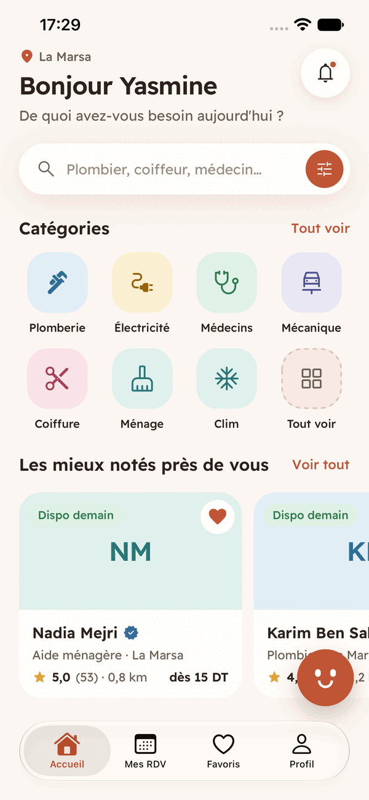
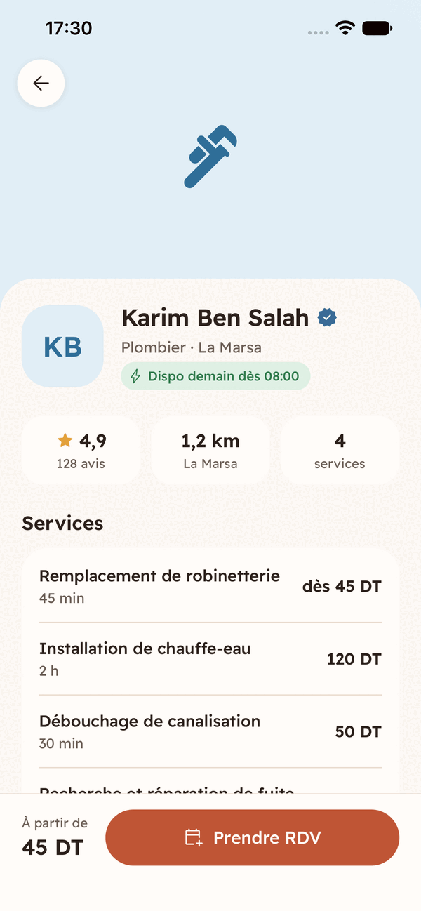
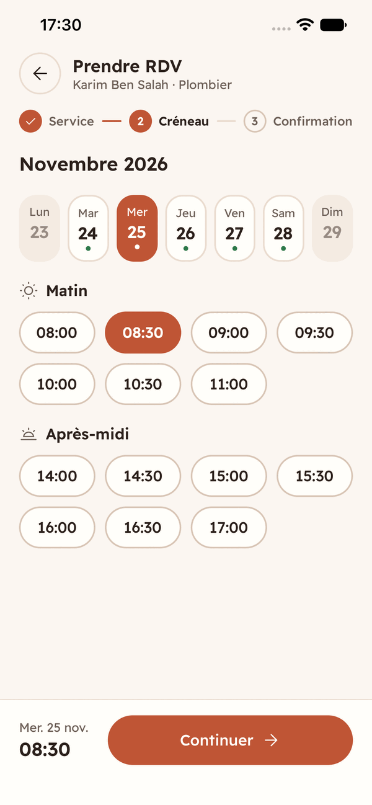
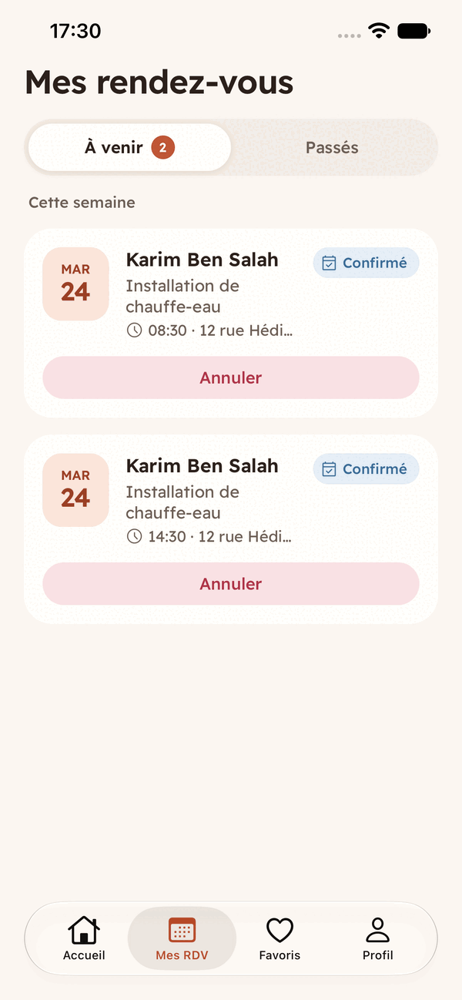
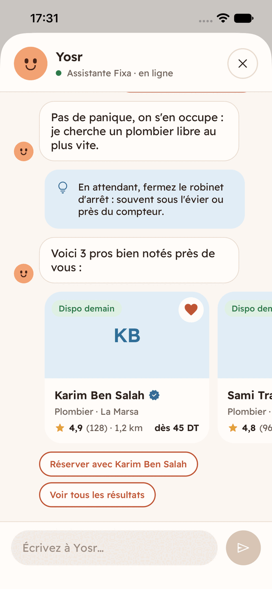
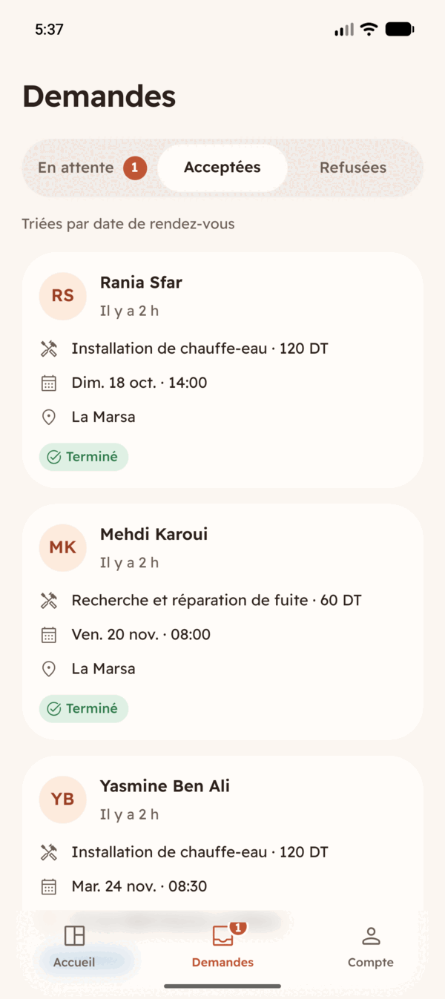
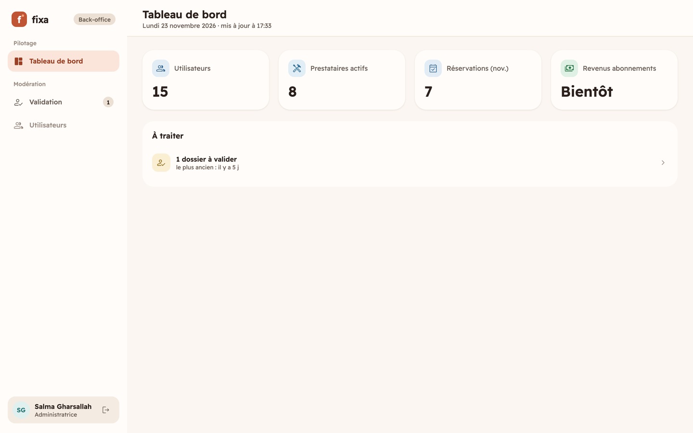
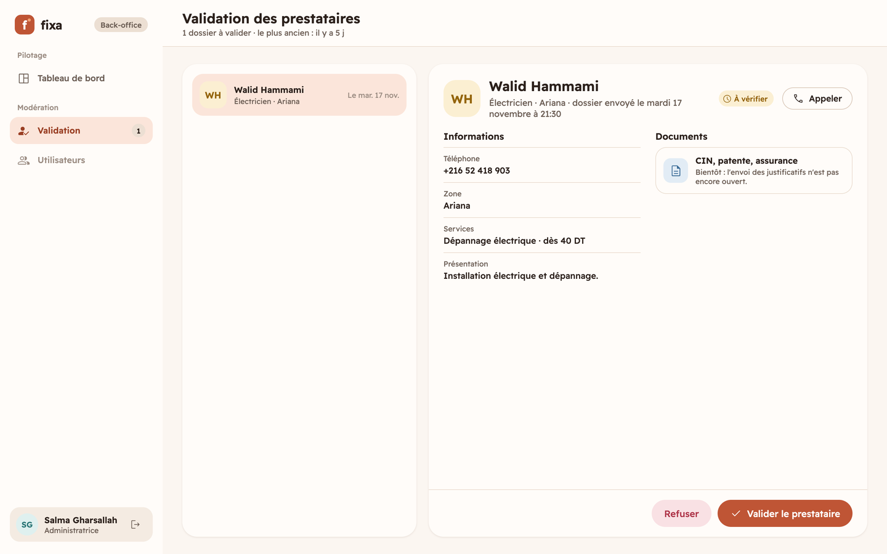

# Fixa

Fixa is an app to find a local professional (plumber, doctor, hairdresser, mechanic) and book an appointment. It has a mobile app for clients and professionals, and a web admin.

This is a school project (PFE preparation), built in November 2026.

<p>
  
  
  
  
  
  
</p>

<p>
  
  
</p>

## Features

- Search by category, filter by rating, price and availability, then open a professional's profile
- Book in three steps: service, time slot, confirmation
- Live status: the client sees the booking change to confirmed as soon as the professional accepts
- Yosr, a chat assistant that reads French, Tunisian Derja, Arabic and English and suggests professionals
- Reviews, favourites, notifications, dark theme, and the app in French, English or Arabic (right to left)
- Web admin with a dashboard and the validation of new professionals

The web admin is online at [6afcd58a003c834b19dc.appwrite.network/admin](https://6afcd58a003c834b19dc.appwrite.network/admin).

## Tech stack

| Part | Built with |
| --- | --- |
| Mobile app | Expo SDK 58, React Native 0.88 (New Architecture), React 19.3, Expo Router, Tamagui 3, Reanimated 4, Gesture Handler, Keyboard Controller |
| Web admin | React 19.3, Vite 8, React Router 8, Tamagui 3 on React Native Web |
| Server | Appwrite Cloud: Auth (email and Google), TablesDB, Realtime, Functions on Node.js 22, Sites for hosting |
| Shared code | TypeScript 6, Zod 4, Bun workspaces |
| Checks | Vitest, Biome |

## Repository layout

| Folder | Contents |
| --- | --- |
| `apps/mobile` | The Expo app for clients and professionals, on iOS and Android. |
| `apps/web` | The web admin. |
| `packages/core` | Shared types, booking rules, texts in three languages and form validation. |
| `packages/ui` | Shared components and theme, used by the mobile app and the web admin. |
| `appwrite/functions/api` | The server function for bookings, reviews and admin actions. |
| `appwrite/functions/worker` | The hourly job that expires unanswered requests and completes past bookings. |
| `appwrite/seed` | The demo data script. |
| `appwrite/appwrite.config.json` | The tables, permissions, functions and hosting setup. |

## Running locally

Requirements:

- Bun 1.3+
- Xcode for iOS, Android Studio for Android

Install, test and start the apps:

```sh
bun install
bun run test
bun run --filter @fixa/mobile android   # or ios
bun run --filter @fixa/web dev
```

The apps use the Appwrite project set in `packages/core/src/ids.ts`. To load the demo data, copy `.env.example` to `.env.local`, fill it in and run `bun run seed`.

---

<p align="center">Made by <a href="https://github.com/SectionTN">SectionTN</a></p>
